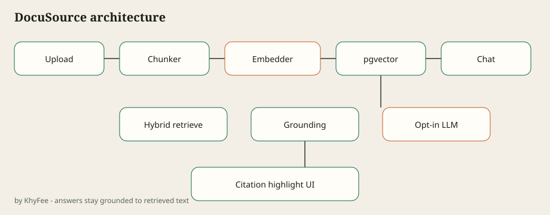

# DocuSource

**Enterprise Knowledge RAG with Direct Citations** by [KhyFee](https://github.com/KhyFee).

Ask internal policy questions and jump to the **exact source paragraph**. Embeddings run locally (sentence-transformers). Answers are grounded extractive by default; OpenAI-compatible summarization is opt-in.

Developed privately before this public release — commit history reflects open packaging of a working tool, not a simulated multi-month timeline.

## Quick start

```bash
npm install
npm run build
npm run dev
# open http://localhost:3000/demo
```

Demo question: *What is our remote hardware budget?* → citation highlights **$1,500**.

## Architecture



## Stack

- Next.js chat + library + citation highlight UI
- FastAPI embedder (`services/embedder`) with MiniLM-L6-v2
- Supabase Auth / pgvector / RLS schema in `supabase/`
- Hybrid retrieval (dense + FTS + RRF/MMR) in `@docusource/retriever`

## Opt-in AI

```bash
DOCUSOURCE_AI=1
OPENAI_API_KEY=...
OPENAI_BASE_URL=   # optional
OPENAI_MODEL=gpt-4o-mini
```

Without AI, chat still answers from retrieved quotes only.

## Scripts

- `npm run doctor` — env diagnostics
- `npm test` — unit tests
- `npm run eval` — golden Q&A (requires running web server)
- Playwright: `npx playwright test`

## Limitations

Long tables and scanned PDFs parse poorly — documents surface `parse_warnings`. OCR is out of scope for v0.1.

## License

MIT © KhyFee
